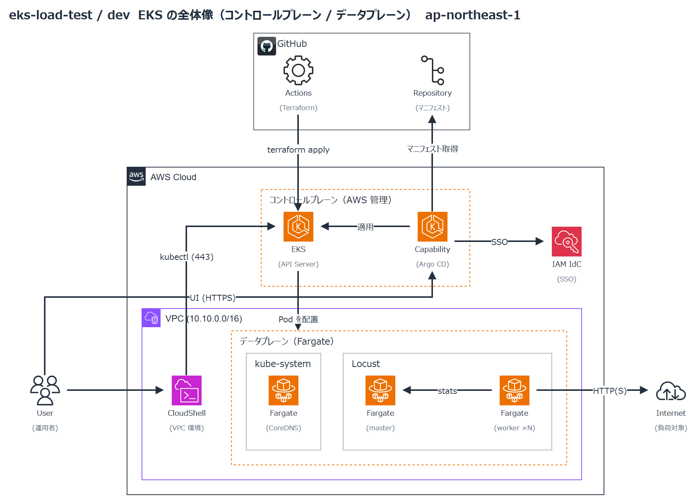

# eks-load-test

EKS（Fargate）+ Locust で負荷試験の環境を構築する。

## 概要



- **コントロールプレーン（AWS 管理）**: EKS の API サーバーと Argo CD（EKS Capabilities）。エンドポイントはプライベートのみで、`kubectl` は VPC 環境の CloudShell から実行する
- **データプレーン（Fargate）**: ワーカーノード（EC2）は置かず、Fargate プロファイルの対象 namespace の Pod を Fargate で動かす
- **Argo CD**: GitHub のマニフェストをクラスタへ同期する。UI へのログインは IAM Identity Center（`argocd-admins` グループが ADMIN）
- **Locust**: master / worker を Fargate で分散実行し、クラスタの外にある公開済みのアプリへ負荷をかける（構築予定）
- dev は使うときだけ GitHub Actions で apply し、終わったら destroy する

## 構成

| 置き場所 | 管理方法 | 中身 |
| --- | --- | --- |
| `terraform/modules/eks-cluster` | Terraform | クラスタ本体、管理者のアクセスエントリ、アドオン（vpc-cni / kube-proxy） |
| `terraform/modules/eks-fargate` | Terraform | Fargate プロファイル、Pod 実行ロール、CoreDNS |
| `terraform/modules/eks-argocd` | Terraform | Argo CD の capability、ロール、アクセスポリシー |
| `k8s/argocd` | `kubectl apply`（CloudShell） | Argo CD に登録するもの（クラスタの Secret、Application） |
| `k8s/locust` | Argo CD が同期 | Locust の manifest（Kustomize） |
| `terraform/environments/<env>` | GitHub Actions（plan / apply / destroy） | 環境ごとのモジュールの呼び出し |

## GitOps（manifest の運用）

- `k8s/locust/` の変更は main へ push すると、Argo CD（Application `locust`）が自動で同期する。差分は Argo CD の画面で見られる
- Application は自動同期（prune・selfHeal あり）。`kubectl` で直接変えたものは Argo CD に戻される。変更は必ず Git 経由で行う
- `k8s/argocd/` は Argo CD 自身に登録するものなので同期の対象外。手で `kubectl apply` する

### クラスタを apply し直したあとの手順

クラスタを作り直すと Argo CD の登録も消えるため、VPC 環境の CloudShell から次の順に実行する（リポジトリを clone しておく）。

1. クラスタの登録（ARN はコミットしないため、実行時に置き換える）

   ```sh
   CLUSTER_ARN=$(aws eks describe-cluster --name dev-eks-load-test --query cluster.arn --output text)
   sed "s|CLUSTER_ARN|${CLUSTER_ARN}|" k8s/argocd/cluster-in-cluster.yaml | kubectl apply -f -
   ```

2. Application（locust）の登録

   ```sh
   kubectl apply -f k8s/argocd/locust.yaml
   ```

3. Argo CD の画面で `locust` が Synced / Healthy になり、`locust` namespace ができていることを確かめる

Argo CD の前提（Identity Center、`argocd-admins`）と UI の URL の確かめ方は、Argo CD の destroy / apply 手順に寄せる（ここでは重複して書かない）。

VPC は terraform-aws-cmn-vpc、Identity Center は terraform-aws-cmn-sso で管理しており、このリポジトリからは参照するだけ。

図は draw.io の XML を埋め込んだ PNG なので、draw.io（VSCode 拡張を含む）でそのまま開いて編集できる。
