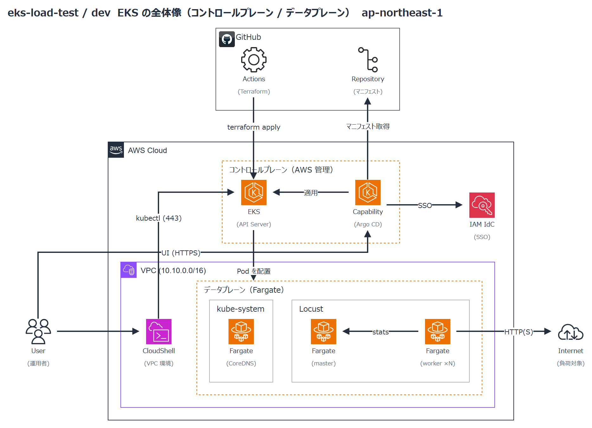

# eks-load-test

EKS（Fargate）+ Locust で負荷試験の環境を構築する。

## 概要

- **コントロールプレーン（AWS 管理）**: EKS の API サーバーと Argo CD（EKS Capabilities）。エンドポイントはプライベートのみで、`kubectl` は VPC 環境の CloudShell から実行する
- **データプレーン（Fargate）**: ワーカーノード（EC2）は置かず、Fargate プロファイルの対象 namespace の Pod を Fargate で動かす
- **Argo CD**: GitHub のマニフェストをクラスタへ同期する。UI へのログインは IAM Identity Center（`argocd-admins` グループが ADMIN）
- **Locust**: master / worker を Fargate で分散実行し、クラスタの外にある公開済みのアプリへ負荷をかける（構築予定）
- dev は使うときだけ GitHub Actions で apply し、終わったら destroy する

## 構成

| 置き場所 | 管理方法 | 中身 |
| --- | --- | --- |
| `terraform/modules/eks-cluster` | Terraform | クラスタ本体、管理者のアクセスエントリ、アドオン（vpc-cni / kube-proxy） |
| `terraform/modules/eks-fargate` | Terraform | Fargate プロファイル、Pod 実行ロール、CoreDNS |
| `terraform/modules/eks-argocd` | Terraform | Argo CD の capability、ロール、アクセスポリシー |
| `terraform/environments/<env>` | GitHub Actions（plan / apply / destroy） | 環境ごとのモジュールの呼び出し |

VPC は terraform-aws-cmn-vpc、Identity Center は terraform-aws-cmn-sso で管理しており、このリポジトリからは参照するだけ。

図は draw.io の XML を埋め込んだ PNG なので、draw.io（VSCode 拡張を含む）でそのまま開いて編集できる。
